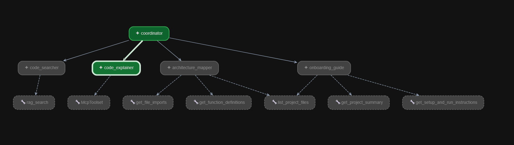
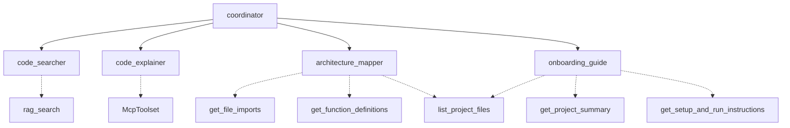

# Multi-Agent Code Helper

## About the Project

This project is a multi-agent code helper built using Python and Google ADK. It helps users understand a Python codebase by searching code, explaining files, showing connections between files, and guiding new developers.

## Architecture





## Agents

- **Coordinator:** Sends questions to the appropriate agent.
- **Code Searcher:** Finds relevant code using RAG.
- **Code Explainer:** Explains the working of a file.
- **Architecture Mapper:** Shows file relationships, functions, and imports.
- **Onboarding Guide:** Helps new developers understand where to start.

## Technologies Used

Python, Google ADK, NVIDIA NIM, Pinecone, LiteLLM, and Filesystem MCP.

## How It Works

The RAG pipeline reads Python files, splits the code into chunks, creates embeddings, stores them in Pinecone, and retrieves relevant chunks for a question. The Code Searcher uses the retrieved code to help answer questions.

## How to Run

Activate the project's virtual environment and make sure the required API keys are configured in `.env`.

```powershell
.\.venv\Scripts\Activate.ps1
adk run code_helper
```

For the web interface, use:

```powershell
adk web
```

Run these commands from the project directory containing the `code_helper` package.

## What I Learned

Through this project, I learned how RAG helps search code, how multiple agents can work together, and how embeddings and vector databases help retrieve relevant information from a codebase.